# 🎙️ Awesome AI Speech & Voice

  

  
  
  
  
  
  

---

## 🌟 Top AI Speech, Voice Cloning & Audio Synthesis Ecosystem

> ⚡ **A comprehensive, SEO-optimized, community-curated list of frontier SaaS platforms and state-of-the-art open-source GitHub repositories for AI Speech, Voice Cloning, Text-to-Speech (TTS), Automatic Speech Recognition (ASR), and Real-Time Conversational Voice Agents.**

*Focused on Instant Zero-Shot Voice Cloning, Long-Form Audio Transcription, Ultra-Low Latency Speech Tokenizers & Expressive Multi-Speaker Generation.*

📅 **Last updated: October 2026**

---

## 📑 Table of Contents

- [📊 Sector Overview & Market Dynamics](#-sector-overview--market-dynamics)
- [🏢 SaaS / Hosted Platforms](#-saas--hosted-platforms)
- [💻 Open-Source GitHub Projects (Sorted by Stars)](#-open-source-github-projects-sorted-by-stars)
  - [Top Tier Speech Foundations](#-top-tier-speech-foundations)
  - [Specialized Engines & Edge Inference](#-specialized-engines--edge-inference)
- [🤝 How to Contribute](#-how-to-contribute)
- [💖 Support](#-support)
- [📈 Star History](#-star-history)
- [⚖️ Disclaimer & Ethics](#️-disclaimer--ethics)

---

## 📊 Sector Overview & Market Dynamics

The global AI voice generation and speech synthesis market is valued at approximately **$4.16B to $7.7B (2025–2026)** and is projected to surpass **$21B+ by 2030**, advancing at a rapid Compound Annual Growth Rate (CAGR) of **~30%**. 

The sector exhibits **moderate fragmentation alongside emerging winner-take-most dynamics**: 
- **Frontier Foundation Voice Model Providers** (such as ElevenLabs) capture massive global developer mindshare and high-volume enterprise API workloads across conversational agents, media localization, and automated support.
- **Vertical Workflow SaaS Leaders** (such as Descript in non-linear audio/video post-production, and Otter.ai in meeting transcription) command high user retention through deeply integrated desktop workflows, collaborative transcripts, and domain-tailored intelligence.
- **The Open-Source Vanguard** (led by OpenAI Whisper, Whisper.cpp, VibeVoice, Coqui TTS, and ChatTTS) offers robust offline, self-hosted, zero-GPU edge inference that matches commercial benchmarks while maintaining full data sovereignty.

---

## 🏢 SaaS / Hosted Platforms

| Company / Product | Size (Valuation / Revenue) | Description & Key Features | Starting Pricing | Free Tier / Trial Limit |
| :--- | :--- | :--- | :--- | :--- |
| **[ElevenLabs](https://elevenlabs.io/)** | **$22B valuation** (~$500M–$600M ARR) | Leading AI voice platform with instant voice cloning, voice design, conversational AI agents, and multilingual dubbing across 30+ languages. | **$6/month** (Starter Plan: 30k credits/mo, instant cloning, commercial license) | **Free Forever Plan**: 10,000 credits/month (~10 min audio), up to 3 custom voices, non-commercial use with attribution |
| **[Resemble AI](https://www.resemble.ai/)** | **$1B–$2.5B est. valuation** ($25M+ raised) | Enterprise voice cloning, real-time speech-to-speech conversion, neural audio watermarking, and deepfake detection security. | **$0 base + pay-as-you-go** (Flex Plan: ~$0.0005/sec for TTS) or **$350/mo** (Team Plan) | **Free Flex Plan**: 1 free custom voice clone creation and trial test credits (no credit card required) |
| **[Descript](https://www.descript.com/)** | **$500M–$1B est. valuation** (~$55M ARR, $101M raised) | AI-first audio/video text-based editor with Overdub voice cloning, Studio Sound enhancement, and automated filler word removal. | **$16/user/month** billed annually ($24/mo monthly; Hobbyist tier: 10 media hrs/mo, 1080p) | **Free Forever Plan**: 60 minutes/month of media transcription/processing, 100 starter AI credits, 720p watermark-free exports |
| **[Otter.ai](https://otter.ai/)** | **$100M+ ARR** ($73M total funding) | AI meeting assistant providing real-time transcription, automated meeting notes, action item extraction, and live collaboration. | **$8.33/user/month** billed annually ($16.99/mo monthly; Pro tier: 1,200 min/mo, 90 min/call) | **Free Forever Plan**: 300 transcription minutes/month (up to 30 min per conversation limit, 3 lifetime media file imports) |
| **[Speechify](https://speechify.com/)** | **~$100M est. valuation** (~$15M–$19M ARR) | Consumer & developer text-to-speech platform featuring celebrity voices, cross-platform PDF/document readers, and voice cloning. | **$11.58/month** billed annually ($139/year; Premium tier: 1,000+ voices, 5x speed, OCR) or $29/mo monthly | **Free Forever Plan**: 10 standard TTS voices, playback speeds up to 1.5x, up to 5 document library limit |
| **[WellSaid Labs](https://wellsaidlabs.com/)** | **~$10M ARR** (Series A, $10M raised) | Enterprise voiceover platform focused on brand-consistent custom voice avatars, pronunciation dictionaries, and corporate governance. | **$19/month** (Starter Plan: ~250 voice downloads/year, standard streaming) or $49/mo (Pro) | **Free Forever / Free Trial Plan**: 3 downloadable minutes/month or 7-day free trial strictly for non-commercial evaluation (no credit card required) |
| **[Podcastle](https://podcastle.ai/)** | **~$9.7M ARR** ($15.3M raised) | Studio-grade podcast recording and editing suite featuring Magic Dust noise reduction, AI voice clones, and video recording. | **$11.99/month** billed annually ($14.99/mo monthly; Storyteller tier) | **Free Forever Plan**: Unlimited audio recording, 1 hour of automatic transcription/month, and basic audio editing |
| **[PlayHT](https://play.ht/)** | **Multi-million ARR** (Series Seed/A venture-backed) | AI voice generation engine with 900+ voices, 142 languages, instant voice cloning, and low-latency conversational voice agent API. | **$39/month** (Professional Plan: 250k words/year, instant voice cloning, commercial rights) | **Free Forever Plan**: 5,000 words/month, non-commercial use with required attribution, access to premium neural voices |
| **[Murf AI](https://murf.ai/)** | **~$2M–$5M ARR** ($11.5M raised) | Studio-quality AI voiceover creator with 120+ voices in 20+ languages, voice changer, and presentation sync for L&D and marketers. | **$19/user/month** billed annually ($29/mo monthly; Creator Plan: 24 hrs voice gen/year, commercial license) | **Free Forever Plan**: 10 minutes total voice generation/transcription per month, full studio editor access (browser preview only; downloads disabled) |
| **[LOVO AI](https://lovo.ai/)** | **$1M–$3M ARR** (Accelerated by Berkeley SkyDeck, $6M raised) | AI voice generator and video editor (Genny) offering 500+ voices across 100+ languages, script generation, and voice cloning. | **$19/month** billed annually ($29/mo monthly; Basic Plan: 2 hrs voice generation/mo) | **14-day Free Trial Plan**: 20 minutes of voice generation credits, watermark-free downloads, and access to all Pro features during the 14-day window |

---

## 💻 Open-Source GitHub Projects (Sorted by Stars)

Every project below is sorted in descending order by GitHub stargazers count, equipped with an official social Stars_Badge linked directly to its stargazers page.

### 🏆 Top Tier Speech Foundations

1. **[OpenAI Whisper](https://github.com/openai/whisper)**   
   **The foundational benchmark for General-Purpose Speech Recognition** (MIT). Trained on 680,000 hours of multilingual and multitask supervised audio collected from the web. Features multilingual speech recognition, speech translation, and voice activity detection with high robustness against accents and background noise.

2. **[Voicebox (jamiepine)](https://github.com/jamiepine/voicebox)**   
   **Multi-engine local voice cloning application** (open-source) packed with four high-performance TTS engines: Qwen3-TTS 1.7B/0.6B, LuxTTS, Chatterbox Multilingual (23 languages), and Chatterbox Turbo. Features paralinguistic emotional controls (`[laugh]`, `[sigh]`, `[gasp]`), unlimited generation length with intelligent audio chunking/crossfading, asynchronous queue pipelines, and multi-GPU acceleration across NVIDIA, Apple Silicon, AMD, and CPU.

3. **[VibeVoice (Microsoft)](https://github.com/microsoft/VibeVoice)**   
   **Microsoft's frontier voice AI family** (MIT) unifying **long-form expressive TTS and diarized ASR** into an integrated architecture. **VibeVoice-ASR** processes **60 minutes of audio in a single pass** outputting structured metadata: *Who (speaker diarization), When (timestamps), and What (transcription)*. **VibeVoice-TTS** synthesizes **up to 90 minutes of multi-speaker conversational dialogue** with continuous speech tokenizers running at a **7.5 Hz ultra-low frame rate** backed by next-token diffusion. Includes built-in AI audio disclaimers, imperceptible acoustic watermarking, and model variants from 0.5B to 7B parameters.

4. **[whisper.cpp](https://github.com/ggml-org/whisper.cpp)**   
   **High-performance C/C++ implementation of OpenAI's Whisper** (MIT). Features plain C/C++ execution without external dependencies, 4-bit/5-bit/8-bit integer quantization via GGML, Apple Silicon Metal acceleration, Vulkan/CUDA GPU support, and real-time streaming speech recognition.

5. **[Coqui TTS](https://github.com/coqui-ai/TTS)**   
   **Deep learning toolkit for Text-to-Speech generation** (MPL-2.0). Features XTTS v2 with zero-shot 3-second voice cloning across 17+ languages, Tacotron2, VITS, YourTTS, and over 40+ pre-trained expressive voice models for research and production pipelines.

6. **[ChatTTS](https://github.com/2noise/ChatTTS)**   
   **Conversational voice foundation model** specifically optimized for dialog scenarios like assistant agents, podcast hosts, and story narration. Features natural conversational filler words, laughter insertion, breath control, and multi-speaker dialogue prosody modeling.

7. **[VoxCPM2](https://github.com/OpenBMB/VoxCPM)**   
   **Fully open-source multilingual speech generation foundation model** (Apache-2.0) from OpenBMB. Unifies 30 languages, 9 regional Chinese dialects, voice design, and style-controllable cloning in a single 2B parameter backbone. Generates 48kHz studio-quality output via AudioVAE V2 with an average 1.68% WER.

8. **[Bark (Suno)](https://github.com/suno-ai/bark)**   
   **Transformer-based text-to-audio foundation model** (MIT) from Suno. Synthesizes expressive speech with natural background noise, music, sound effects, sighs, hesitations, laughter, and emotional inflections across multiple languages.

9. **[OpenVoice (MyShell)](https://github.com/myshell-ai/OpenVoice)**   
   **Versatile instant voice cloning framework** (MIT). Disentangles voice style, tone color, emotion, accent, rhythm, pauses, and pitch. Enables cloning voice timbre from short audio samples while granularly controlling emotion and delivery language.

10. **[Fish Speech](https://github.com/fishaudio/fish-speech)**   
    **Frontier text-to-speech architecture** with DualAR and VQ-GAN audio tokenizers. Delivers ultra-low latency, zero-shot voice cloning, emotional prosody, and multilingual synthesis for real-time voice agents.

11. **[faster-whisper](https://github.com/SYSTRAN/faster-whisper)**   
    **Reimplementation of Whisper using CTranslate2** (MIT). Delivers up to **4x faster transcription** speed than OpenAI Whisper while consuming significantly less GPU/CPU memory with INT8/FP16 quantization.

12. **[WhisperX](https://github.com/m-bain/whisperX)**   
    **Time-accurate speech transcription framework** (BSD-2-Clause) with phoneme-level word alignment via wav2vec 2.0, multi-speaker diarization using PyAnnote, and batched inference for 70x real-time transcription speeds.

13. **[Qwen3-TTS](https://github.com/QwenLM/Qwen3-TTS)**   
    **Alibaba's multilingual TTS family** (Apache-2.0) with **3-second voice cloning** and description-based voice design. Trained on 5 million hours of speech across 10 languages using a dual-track LM architecture for real-time synthesis (0.6B and 1.7B parameter variants).

14. **[Piper](https://github.com/rhasspy/piper)**   
    **Fast, local neural text-to-speech engine** (MIT) optimized for Raspberry Pi and single-board edge computers using VITS models. Generates real-time natural speech with negligible CPU overhead.

15. **[MeloTTS (MyShell)](https://github.com/myshell-ai/MeloTTS)**   
    **High-speed multilingual TTS library** supporting English, Spanish, French, Chinese, Japanese, and Korean. Designed for ultra-fast CPU inference and seamless integration in interactive conversational agents.

16. **[MetaVoice-1B](https://github.com/metavoiceio/metavoice-src)**   
    **1.2B parameter foundation model** trained on 100K hours of speech (Apache-2.0). Features zero-shot cloning with 30s reference audio, emotional speech prosody, fine-tuning support, and multi-band diffusion waveform generation.

17. **[stable-ts](https://github.com/jianfch/stable-ts)**   
    **Stabilized timestamping framework for Whisper** (MIT). Uses cross-attention weights and dynamic time warping to generate ultra-precise word-level timestamps, eliminating hallucinated repeats and missing segments.

18. **[SpeechT5 (Microsoft)](https://github.com/microsoft/SpeechT5)**   
    **Unified-modal encoder-decoder pre-training** for speech and text processing (MIT). Handles spoken language identification, speech-to-speech translation, voice conversion, and neural TTS.

19. **[Vocalinux](https://github.com/VocaHQ/vocalinux)**   
    **Voice dictation utility for Linux** (open-source) that streams text directly into active windows. Supports whisper.cpp (Vulkan), Faster Whisper, VOSK, and Parakeet across AppImage, Flatpak, Snap, and AUR.

20. **[chttr](https://github.com/robjobbed/chttr)**   
    **Local privacy-first meeting notes and voice dictation for Linux**. Uses local Parakeet ASR, PipeWire system audio capture, WeSpeaker voice embeddings for speaker naming, and Claude-powered markdown generation.

---

### ⚡ Specialized Engines & Edge Inference

- **[VibeVoice-ASR-BitNet](https://github.com/microsoft/VibeASR.cpp)** — Edge CPU inference engine for VibeVoice-ASR. Heterogeneous quantization (`I8_S` + `I2_S`) compresses the model from 4.62 GB to 1.58 GB with real-time inference (RTF < 1) on 3+ CPU threads without GPU requirements.
- **[Audio8-TTS-0.1B-ONNX-INT8](https://aihub.caict.ac.cn/models/Audio8/Audio8-TTS-0.1B-ONNX-INT8)** — Ultra-lightweight multilingual TTS (~100M params, ~0.6GB footprint) running ~19ms per token on standard 8-thread CPUs across 11 languages.
- **[EmbeddingGemma-2-Transcribe-LiteRT](https://huggingface.co/mlboydaisuke/EmbeddingGemma-2-Transcribe-LiteRT)** — On-device Android speech-to-text with all weights and audio processed locally on mobile hardware.
- **[Qwen3-TTS mlx-audio](https://github.com/Blaizzy/mlx-audio)** — Native Apple Silicon MLX port of Qwen3-TTS.

---

## 🤝 How to Contribute

Contributions are welcome and highly appreciated! To submit a new SaaS product, open-source tool, or optimization framework:

1. 🍴 **Fork the repository** on GitHub.
2. 📝 **Add or update the entry** in [`README.md`](README.md):
   - Include tool name, official link, Stars_Badge (if open-source), concise feature summary, pricing, and free tier limits.
   - For open-source tools, maintain descending sort order based on Stars_Counts.
3. 🚀 **Submit a Pull Request** with a brief summary of additions and official references.

---

## 💖 Support

If you find this curated ecosystem directory useful, please consider:
- ⭐ **Starring this repository** to help others discover it.
- 🍴 **Forking and sharing** with AI researchers, podcasters, and developers.
- ☕ **Sponsoring the project** to fuel ongoing curation, benchmarking, and updates:
  
  👉 **[Sponsor on GitHub Sponsor Dashboard](https://github.com/sponsors/ishandutta2007)**

Thank you for supporting open, accessible, and ethical AI voice technology!

---

## 📈 Star History

---

## ⚖️ Disclaimer & Ethics

- This repository is a **community-curated directory** for educational, engineering, and research purposes.
- **Explicit Voice Cloning Consent**: AI speech and voice synthesis tools must comply with strict voice cloning consent requirements, wiretapping statutes, and privacy laws (GDPR, CCPA, EU AI Act Article 50). **Never clone a voice without recorded explicit consent.**
- **Watermarking & Transparency**: In accordance with modern voice AI safety protocols, synthetic speech deployments should utilize audio disclaimers, cryptographic watermarks, and transparent provenance indicators.
- **Prohibited Use**: Malicious impersonation, unconsented deepfakes, fraud, phishing, or harassment are strictly condemned.

---

  <b>Built with ❤️ for voice researchers, podcasters, accessibility engineers, and AI developers.</b>

